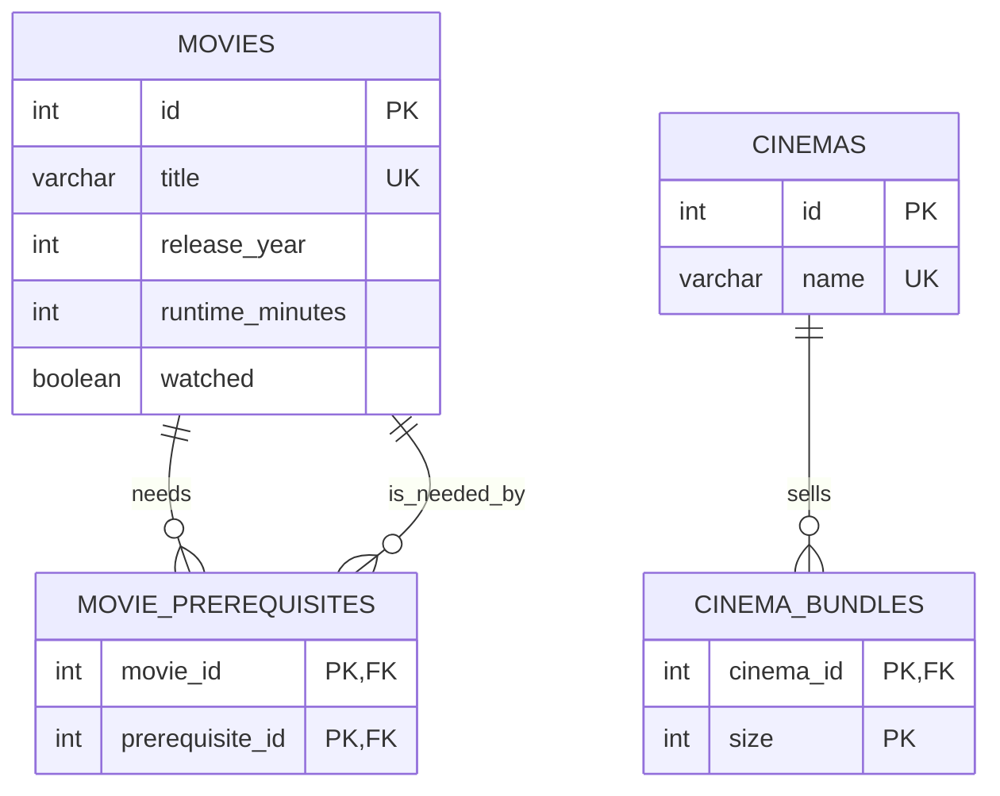

# Doomsday Ready

A small full-stack app that helps MCU fans plan their rewatch before *Avengers: Doomsday* and book an opening-night watch party.

- **Rewatch plan:** add movies with prerequisites and get the ordered list of what to watch first.
- **Watch-party booking:** given a cinema and a group size, find the fewest seat bundles that add up to exactly that many seats.

## Tech stack

- **Frontend:** React (Vite)
- **Backend:** Node.js, Express
- **Database:** PostgreSQL (plain SQL with `pg`, no ORM)
- **Other:** Docker Compose, Node's built-in test runner

## Run it

```bash
docker compose up --build
```

Open http://localhost:5173 (the API is on http://localhost:3000). To load the sample data (the 8 MCU movies and the 4 example cinemas), run this in a second terminal:

```bash
docker compose exec backend npm run db:seed
```

## Run the tests

```bash
cd backend
npm test
```

17 unit tests cover the cycle check, the rewatch order and the booking quote, using the examples from the challenge.

## API

All endpoints are under `/api`.

| Method and path | Purpose |
|---|---|
| `POST /movies` | Create a movie |
| `GET /movies` | List movies |
| `PATCH /movies/:id` | Update a movie, including `watched` and `prerequisites` |
| `GET /movies/:id/rewatch-order` | Rewatch order (feature 1) |
| `POST /cinemas` | Create a cinema |
| `GET /cinemas` | List cinemas |
| `GET /cinemas/:id/booking?groupSize=6` | Booking quote (feature 2) |

A circular prerequisite is rejected with `409 CIRCULAR_DEPENDENCY`. Errors always look like `{ "error": { "code": "...", "message": "..." } }`.

## Data model



`movie_prerequisites` stores the links of the prerequisite graph. The full schema is in `backend/src/db/schema.sql`.

## Algorithms (written without libraries)

- **Cycle detection:** depth-first search that checks whether a movie can be reached again through its new prerequisites. The error message shows the loop.
- **Rewatch order:** depth-first search that adds a movie only after all of its prerequisites (post-order), with a `visited` set so nothing repeats. The target is removed at the end.
- **Booking quote:** dynamic programming (minimum coin change). Greedy does not work: with bundles 1, 3, 4 and a group of 6, greedy gives 4 + 1 + 1, but 3 + 3 is better.

## Assumptions and decisions

- `runtimeMinutes` is 1 to 300. The brief gives no range for the release year, so I accept 1888 to 2100.
- Prerequisites are sent as a list of movie ids, and updating them replaces the whole list.
- Movie titles and cinema names are unique. Duplicates return `409`.
- A cinema has 1 to 10 different bundle sizes, each from 1 to 500. Repeated sizes are rejected.
- `groupSize` must be a whole number from 1 to 10,000.
- "Not possible" is a normal answer, returned as `200` with `possible: false`.
- If several combinations use the same minimum number of bundles, one of them is returned.
- The rewatch order counts (`watchedCount`, `totalCount`, `remainingRuntimeMinutes`) describe the prerequisites only, not the target movie.

## How I used AI tools

- **Setup and backend:** planning the stack, the SQL schema, and the Express routes, services and validators.
- **Algorithms:** Claude explained the ideas and helped me write them. They use no libraries that solve these problems.
- **Tests and frontend:** Claude helped write the unit tests and some of the the React views.
- **Troubleshooting:** I used it to understand errors from Docker, git and the terminal.

I ran and tested everything myself with `curl`, the unit tests and the browser, and I am responsible for all the code in this repository.
